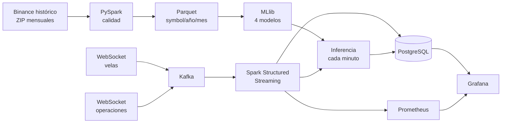

---
hide:
  - navigation
---

Big Data · UPeU 2026-2 · Grupo 3

# CryptoPulse · Monitoreo de riesgo de BTC y SOL

¿Cómo puede un analista de riesgo anticipar, con 5 a 30 minutos de antelación, condiciones de riesgo en BTC y SOL: volatilidad alta, caídas fuertes, actividad anómala y desacople entre ambos activos?

<a class="cp-button" href="instalacion/">Levantar el sistema</a>
<a class="cp-button secondary" href="proyecto-sello/">Proyecto Sello</a>
<a class="cp-button secondary" href="https://github.com/Milagros-hp/BigData-BTC-SOL">Repositorio</a>

4 993 757velas históricas válidas (2022–2026)

2 flujosen Kafka: velas y operaciones ejecutadas

7 / minpronósticos en vivo, uno por serie

4 de 4modelos que superan su referencia en 2026

## Cuatro dimensiones, un solo tablero

15 MIN · RANDOM FOREST

### Volatilidad

¿Cuánto se va a mover el precio? Error 14 % menor que la referencia.

**Franck Albertson Coaquira Justo**

30 MIN · LOGÍSTICA

### Caídas fuertes

¿Qué probabilidad hay de una caída dentro del 5 % de peores históricas? AUC-PR 3 veces la referencia.

**Julmer Quispe Apaza**

5 MIN · LOGÍSTICA

### Actividad anómala

¿Se viene volumen inusual para esa hora del día? AUC-PR 9 veces la referencia.

**Abdul Quispe Condori**

15 MIN · RIDGE

### Divergencia BTC–SOL

¿Cuánto se van a separar SOL y BTC? Error 25 % menor que la referencia.

**Luz Milagros Huanca Pacco**

## Arquitectura Lambda

### Capa batch
4,99 millones de velas de Binance → calidad con PySpark → Parquet particionado → cuatro modelos Spark MLlib validados en el tiempo.

### Capa de velocidad
Velas y operaciones en vivo → Kafka → Spark Structured Streaming con ventanas, watermark y checkpoints → inferencia en cada cierre de minuto.

El sistema no ejecuta órdenes ni da recomendaciones de inversión: entrega **señales de vigilancia y alerta** para saber cuándo revisar el mercado.

## Por dónde empezar

### [Instalación y ejecución](instalacion.md)
Levantar todo desde cero con un comando.

### [Brief técnico-analítico](proyecto-sello/brief.md)
Pregunta central, dimensiones y fichas por integrante.

### [Notebooks U1](notebooks-u1.md)
El análisis batch y el modelo de cada integrante.

### [Uso del tablero](PRODUCTO_FINAL.md)
Cómo leer Grafana: estado, señales y pronósticos.

