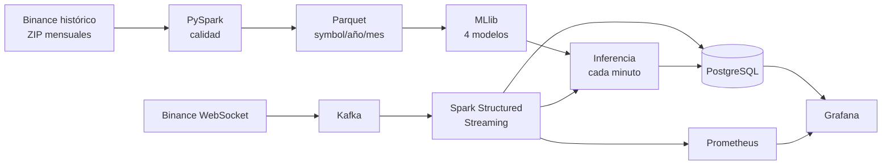

# CryptoPulse · Monitoreo de riesgo de BTC y SOL

**Curso:** Big Data · UPeU 2026-2 · **Grupo 3**
**Repositorio:** <https://github.com/Milagros-hp/BigData-BTC-SOL>

| Integrante | Dimensión |
|---|---|
| Franck Albertson Coaquira Justo | Volatilidad |
| Julmer Quispe Apaza | Caídas significativas |
| Abdul Quispe Condori | Actividad anómala |
| Luz Milagros Huanca Pacco | Divergencia BTC–SOL |

!!! tip "Exposición de la Unidad 2"
    La presentación y las evidencias por integrante están en [Exposición U2](u2/index.md).

## Problema

Quien analiza criptomonedas necesita saber, minuto a minuto, si BTC o SOL entran en una condición de riesgo y qué puede pasar en los próximos minutos. CryptoPulse responde la pregunta central del equipo:

> ¿Cómo puede un analista de riesgo anticipar, con 5 a 30 minutos de antelación, condiciones de riesgo en BTC y SOL: volatilidad alta, caídas fuertes, actividad anómala y desacople entre ambos activos?

## Solución

Un sistema Big Data con **arquitectura Lambda**:

- **Capa batch:** 4,99 millones de velas reales de Binance (2022–2026) → calidad con PySpark → Parquet particionado → cuatro modelos Spark MLlib validados en el tiempo.
- **Capa de velocidad:** WebSocket de Binance → Kafka → Spark Structured Streaming (ventanas, watermark, checkpoints) → inferencia en cada cierre de minuto → PostgreSQL. Dos flujos: **telemetría** (velas de 1 minuto) y **eventos empresariales** (cada operación ejecutada, agregada en flujo comprador/vendedor).
- **Consumo:** un solo tablero Grafana con estado, señales, pronósticos, evaluación de modelos, observabilidad y costos.

## Valor para la decisión

| Dimensión | Pregunta que responde | Horizonte |
|---|---|---|
| Volatilidad | ¿Cuánto se va a mover el precio? | 15 min |
| Caídas | ¿Qué probabilidad hay de una caída fuerte? | 30 min |
| Actividad anómala | ¿Se viene un pico de volumen u operaciones? | 5 min |
| Divergencia | ¿Cuánto se van a separar SOL y BTC? | 15 min |

El sistema no ejecuta órdenes ni da recomendaciones de inversión: entrega señales para revisar el mercado.

## Por dónde empezar

- [Instalación y ejecución](instalacion.md): levantar todo desde cero.
- [Brief técnico-analítico](proyecto-sello/brief.md): pregunta central, dimensiones y fichas por integrante.
- [Notebooks U1](notebooks-u1.md): el análisis batch de cada integrante.
- [Uso del tablero](PRODUCTO_FINAL.md): cómo leer Grafana.
- [Pruebas y hardening](hardening.md): qué se verificó y cómo.
