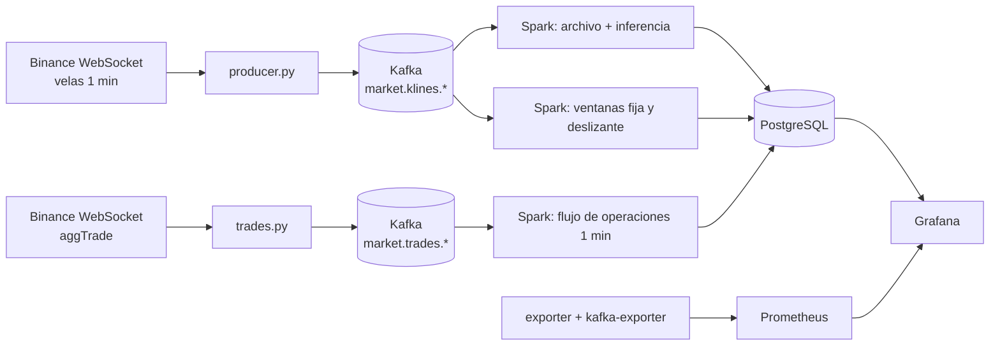

# Producto de Unidad 2 · CryptoPulse

Plantilla del docente: [Producto U2](https://262bigdata.github.io/lambda26/proyecto-sello/u2-producto/).

## Producto

**Pipeline en tiempo real con ingesta de eventos empresariales y telemetría de mercado, procesamiento streaming con Spark, observabilidad/costos y salidas BI/ML distribuidas.**



## 1. Capacidades por sesión

| Sesión | Capacidad | Cómo la cumple CryptoPulse | Evidencia |
|---|---|---|---|
| S6 | Ingesta de eventos empresariales | Cada operación ejecutada en Binance (precio, cantidad, comprador o vendedor) se publica en `market.trades.btcusdt` y `market.trades.solusdt` | `cryptopulse/trades.py`, contrato `schemas/market-trade-v1.schema.json`, `test_trades.py` |
| S7 | Ingesta IoT/sensores | La vela de 1 minuto es la **telemetría del mercado**: una lectura periódica, como un sensor. WebSocket con recuperación REST, sin datos simulados | `cryptopulse/producer.py`, contrato `schemas/market-kline-v1.schema.json` |
| S8 | Streaming con ventanas, watermark y checkpoints | 4 consultas: archivo idempotente; ventana fija de 5 min; ventana deslizante de 5 min con paso de 1 min (watermark de 2 min); flujo de operaciones por minuto (watermark de 1 min). Deduplicación por `event_id` y checkpoint por consulta | `cryptopulse/stream.py`; pruebas `watermark_rows_dropped` y `checkpoint_restart_recovered` |
| S9 | Observabilidad y costos | Prometheus con 3 destinos y 8 reglas de alerta; sección *Operación* del tablero; costo estimado | `observability/`, `cryptopulse/exporter.py`, sección 3 de esta página |
| S10 | Series de tiempo e inferencia en streaming | En cada cierre de minuto se aplican los 4 modelos a las últimas 61 velas: 7 pronósticos (3 dimensiones × 2 activos + divergencia). Cada pronóstico se evalúa al madurar su horizonte | `cryptopulse/inference.py` |
| S11 | BI/ML: KPIs y predicción en la misma vista | Tablero único con estado, señales, pronóstico frente a realidad posterior, evaluación en vivo y flujo de operaciones | `observability/grafana/dashboards/cryptopulse.json` |

## 2. Dimensión U2 de cada integrante

| Integrante | Pregunta U2 | Modelo en vivo | Panel |
|---|---|---|---|
| Franck | ¿Qué volatilidad tendrá cada activo en los próximos 15 min? | Random Forest | *Volatilidad · observada y futura a 15 min* |
| Julmer | ¿Qué probabilidad hay de una caída fuerte en los próximos 30 min? | Logística calibrada | *Caída significativa · probabilidad a 30 min* |
| Abdul | ¿Qué probabilidad hay de volumen inusualmente alto en los próximos 5 min? | Logística calibrada | *Actividad anómala · probabilidad a 5 min* |
| Luz Milagros | ¿Qué tamaño de separación SOL–BTC se espera en los próximos 15 min? | Ridge | *Separación BTC–SOL · tamaño \|SOL − BTC\| a 15 min* |

Validación de cada modelo: tabla *Prueba histórica reservada* (enero–septiembre 2026) y tabla *Evaluación en vivo* (error real de los pronósticos ya madurados).

## 3. Costos y criterios de escalado

### Volumen real medido (29 de octubre de 2026)

| Flujo | Mensajes | Tamaño en Kafka | Retención de 7 días |
|---|---|---|---|
| Velas (2 tópicos) | 2 por minuto, 2 880 por día | ~0,7 KB por mensaje | ~14 MB |
| Operaciones BTC | 612 por minuto en promedio; pico de 3 547 | ~0,4 KB por mensaje | ~2,4 GB |
| Operaciones SOL | 193 por minuto en promedio; pico de 1 407 | ~0,4 KB por mensaje | ~0,8 GB |

Spark procesa un micro-lote cada 15 s. El lote de archivo + inferencia tarda **8,6 s en promedio** (máximo de 34 s en una recuperación). El lag de Kafka está en 0.

### Costo estimado

```text
costo mensual = 730 h × (3,5 núcleos × 0,02 USD + 5,5 GiB × 0,003 USD) + 20 GiB × 0,10 USD = 65,15 USD/mes
```

Las tarifas son ilustrativas y editables en `config/cost-assumptions.json` (`scripts/actualizar_costos.ps1` recalcula). Se muestran en el panel *Escenario de costo · sin facturación* del tablero.

### Cuándo escalar

| Señal medida | Umbral | Acción | Por qué |
|---|---|---|---|
| Duración del lote de archivo | Más de 15 s sostenidos (hoy 8,6 s) | Pasar Spark de `local[2]` a `local[4]` o separar la inferencia en otro servicio | Si el lote dura más que el intervalo, se acumula retraso |
| Lag de Kafka (`cryptopulse_kafka_checkpoint_lag`) | Más de 100 durante 2 min (alerta `CryptoPulseKafkaLag`) | Más particiones y consumidores | Spark no alcanza al productor |
| Disco de Kafka | Más de 10 GB | Bajar la retención de `market.trades.*` a 48 h | Las operaciones son el 99 % del volumen; las velas son mínimas |
| Más activos | Más de 6 pares | Clúster Spark (Standalone o Kubernetes) | La inferencia crece de forma lineal con los activos (~1–2 s por activo y minuto) |
| Picos de operaciones | Más de 50 000 por lote (`maxOffsetsPerTrigger`) | Subir el límite o el intervalo | Evita lotes gigantes en noticias o liquidaciones |

## 4. Rúbrica y evidencia

| Criterio | Peso | Evidencia para la demo en vivo |
|---|---:|---|
| 1. Eventos empresariales mediante Kafka | 12% | Kafka UI → `market.trades.btcusdt` → *Messages*; contrato en `schemas/market-trade-v1.schema.json`; panel *Flujo neto comprador − vendedor* |
| 2. Eventos IoT/sensores | 10% | Kafka UI → `market.klines.*`; panel *Frescura y continuidad* con 61/61 velas y 0 faltantes |
| 3. Streaming con Spark | 14% | `stream.py` (4 consultas, watermark, checkpoints); tabla *Ventanas finalizadas*; `scripts/pruebas_integracion.ps1` |
| 4. Observabilidad | 12% | Sección *Operación* del tablero; Prometheus `/targets` y `/alerts`; caso de error con `prueba_recuperacion.ps1` |
| 5. Costos y escalado | 8% | Sección 3 de esta página y panel *Escenario de costo · sin facturación* |
| 6. Salidas BI/ML | 12% | Tablero *CryptoPulse · BTC y SOL*: estado LISTO 7/7, centro de señales e historial |
| 7. Series de tiempo e inferencia validada | 12% | Paneles por dimensión (pronóstico frente a real), *Prueba histórica reservada* y *Evaluación en vivo* |
| 8. Sustentación | 20% | Cada integrante presenta su panel U2 |

## Guion sugerido para la demo de S12

1. `iniciar_producto.ps1` → **LISTO** y 7/7 en Grafana.
2. Kafka UI: mostrar un mensaje de vela y uno de operación (contratos).
3. Grafana, por integrante: su panel, el pronóstico, la realidad posterior y su error.
4. Sección de operaciones: flujo comprador/vendedor.
5. Prometheus: destinos *UP* y reglas.
6. Caso de error: `prueba_recuperacion.ps1` → DEGRADADO → LISTO.
