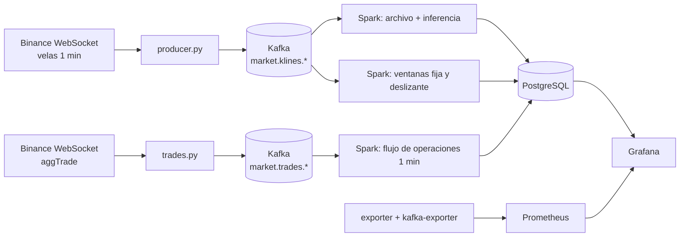

# Producto de Unidad 2 · CryptoPulse

Sigue la estructura de la [plantilla del docente](https://262bigdata.github.io/lambda26/proyecto-sello/u2-producto/). La versión para exponer está en [Exposición U2](../u2/index.md).

## Producto

**Pipeline en tiempo real con ingesta de eventos empresariales y telemetría de mercado, procesamiento streaming con Spark, observabilidad, costos y salidas BI/ML.**



## 1. Alcance de capacidades por sesión

| Sesión | Capacidad | Cómo la cumple CryptoPulse | Responsable | Evidencia |
|---|---|---|---|---|
| [S6](../u2/sesiones.md#s6) | Ingesta de eventos empresariales | Cada operación ejecutada se publica en `market.trades.btcusdt` y `market.trades.solusdt`, y se recupera por REST tras una caída | Julmer | `trades.py`, `market-trade-v1.schema.json`, `test_trades.py` |
| [S7](../u2/sesiones.md#s7) | Ingesta IoT/sensores | La vela de 1 minuto es telemetría real del mercado, con WebSocket y recuperación REST | Julmer | `producer.py`, `market-kline-v1.schema.json` |
| [S8](../u2/sesiones.md#s8) | Streaming con ventanas, watermark y checkpoints | 4 consultas, deduplicación por `event_id` y checkpoint por consulta | Julmer | `stream.py`, `pruebas_integracion.ps1` |
| [S9](../u2/sesiones.md#s9) | Observabilidad y costos | Prometheus con 3 destinos y 11 alertas; sección *Operación* del tablero; costo estimado | Abdul | `observability/`, `exporter.py`, [costos](#costos) |
| [S10](../u2/sesiones.md#s10) | Series de tiempo e inferencia | 7 pronósticos por minuto; cada uno se evalúa al madurar su horizonte | Los cuatro | `inference.py` |
| [S11](../u2/sesiones.md#s11) | BI/ML en la misma vista | Tablero único con KPIs, señales, pronósticos y evaluación | Luz Milagros | `cryptopulse.json` |
| [S12](../u2/sesiones.md#s12) | Pipeline ensamblado y sustentado | Verificación integral y pruebas de recuperación | Luz Milagros y equipo | `scripts/`, [guion](../u2/demo.md) |

Dimensión de cada integrante: [Franck](../u2/franck.md), [Julmer](../u2/julmer.md), [Abdul](../u2/abdul.md) y [Luz Milagros](../u2/luz.md).

## 2. Rúbrica de evaluación

La columna *Nivel A* resume lo que pide la rúbrica del docente para 20 puntos.

| # | Criterio | Peso | Nivel A | Evidencia en CryptoPulse |
|---|---|---:|---|---|
| 1 | Eventos empresariales con Kafka | 12 % | Publicados y consumidos en vivo, con contrato y tópico documentados | Kafka UI, `market-trade-v1.schema.json`, panel de flujo neto |
| 2 | Eventos IoT/sensores | 10 % | Integrados al mismo pipeline, con esquema y volumen ajustados y verificados | `market.klines.*`, panel de frescura, [volumen](#volumen) |
| 3 | Spark Structured Streaming | 14 % | Ventanas, watermark y checkpoints verificados en vivo con datos reales | `stream.py`, tabla de ventanas, `pruebas_integracion.ps1` |
| 4 | Observabilidad | 12 % | Panel operativo con métricas correlacionadas | Sección *Operación*, Prometheus, `prueba_recuperacion.ps1` |
| 5 | Costos y escalado | 8 % | Documentados y justificados frente al volumen real | [Sección de costos](#costos) |
| 6 | Salidas BI/ML | 12 % | Tablero con KPIs en tiempo real, verificado en vivo | Tablero *CryptoPulse · BTC y SOL* |
| 7 | Series de tiempo o inferencia validada | 12 % | Modelo validado con métricas e integrado al tablero | *Prueba histórica reservada* y *Evaluación en vivo* |
| 8 | Sustentación | 20 % | Aporte individual claro y respuestas precisas | [Exposición](../u2/index.md), [guion](../u2/demo.md) y páginas por integrante |

## 3. Trazabilidad

| Criterios | Procedencia según la plantilla | Dónde se cumple |
|---|---|---|
| 1 a 5 | Infraestructura técnica del sílabo | S6 a S9 |
| 6 | Completa CE044-N3 | S11 |
| 7 | Completa CE043-N3 | S10 |
| 8 | Competencia general, sesión 12 | S12 |

## Anexo · Costos y criterios de escalado { #costos }

### Volumen real medido { #volumen }

Medición del 30 de octubre de 2026, durante unos 60 minutos:

| Flujo | Promedio por minuto | Pico por minuto | Eventos |
|---|---:|---:|---|
| Velas | 2 | 2 | 2 tópicos |
| Operaciones BTC | 1 153 | 2 513 | 64 555 |
| Operaciones SOL | 271 | 815 | 15 189 |

El 29 de octubre se habían medido 612 y 193 operaciones por minuto: el volumen varía casi al doble entre días, y por eso los umbrales se fijan sobre señales y no sobre un promedio.

- **Disco de Kafka:** los logs crecieron 34,9 MB en esa hora, lo que proyecta **unos 5,9 GB a 7 días** de retención con el volumen de ese día.
- **Índices:** el volumen de Kafka muestra además unos 1,4 GB ocupados desde el arranque, porque cada una de las 72 particiones reserva 20 MB de índices. No son datos.
- **Spark:** micro-lote cada 15 s; el lote de archivo e inferencia tarda 4,6 s en promedio y 14,8 s como máximo.

### Costo estimado

```text
costo mensual = 730 h × (3,5 núcleos × 0,02 USD + 5,5 GiB × 0,003 USD) + 20 GiB × 0,10 USD = 65,15 USD/mes
```

Las tarifas son ilustrativas y editables en `config/cost-assumptions.json`. Los 20 GiB de disco cubren la retención proyectada. `scripts/actualizar_costos.ps1` recalcula y el resultado aparece en *Escenario de costo · sin facturación*.

### Cuándo escalar

| Señal medida | Umbral | Acción | Por qué |
|---|---|---|---|
| Duración del lote | Más de 15 s sostenidos (hoy 4,6 s de media) | Pasar Spark de `local[2]` a `local[4]` o separar la inferencia | Si el lote dura más que el intervalo, se acumula retraso |
| Velas pendientes en Kafka | Más de 100 durante 2 min (`CryptoPulseKafkaLag`) | Más particiones y consumidores | Spark no alcanza al productor |
| Operaciones pendientes en Kafka | Más de 5 000 durante 2 min (`CryptoPulseTradesLag`) | Subir recursos de la consulta de operaciones | Un lote normal ya trae cientos de operaciones |
| Disco de Kafka | Más de 10 GB | Bajar la retención de `market.trades.*` a 48 h | Las operaciones son casi todo el volumen |
| Más activos | Más de 6 pares | Clúster Spark (Standalone o Kubernetes) | La inferencia crece con los activos |
| Picos de operaciones | Más de 50 000 por lote (`maxOffsetsPerTrigger`) | Subir el límite o el intervalo | Evita lotes gigantes en noticias o liquidaciones |
