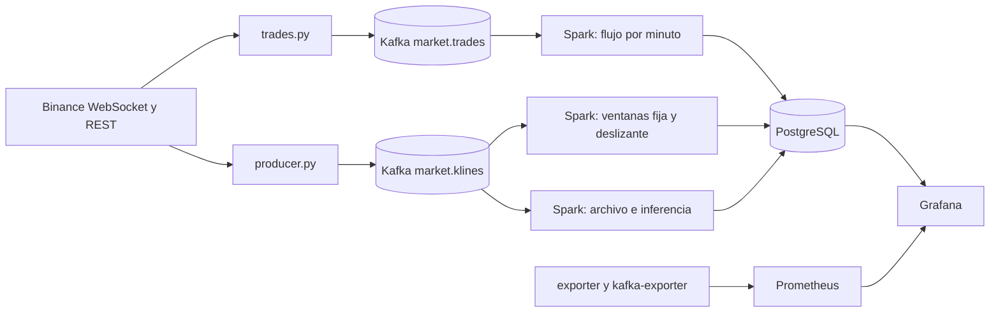

# Producto de Unidad 2 · CryptoPulse

Sigue la [plantilla del docente](https://262bigdata.github.io/lambda26/proyecto-sello/u2-producto/). El instrumento es el declarado en el [Brief técnico-analítico](brief.md). La sustentación por dimensión está en [Exposición U2](../u2/index.md).

## Producto

Pipeline en tiempo real con ingesta de eventos empresariales y telemetría de mercado, procesamiento streaming con Spark, observabilidad/costos y salidas BI/ML distribuidas.



## 1. Alcance de capacidades por sesión

**Tabla 1. De la sesión a la capacidad del sistema**

| Sesión | Capacidad que agrega | Cómo lo hace CryptoPulse | Responsable |
|---|---|---|---|
| [S6](../u2/sesiones.md#s6) | Ingesta de eventos empresariales en tiempo real. | Cada operación ejecutada en Binance se publica y consume con Kafka en `market.trades.*`, con contrato y tópicos documentados. | Julmer |
| [S7](../u2/sesiones.md#s7) | Ingesta de eventos IoT/sensores en tiempo real. | Telemetría real de mercado: velas de 1 minuto en `market.klines.*`, en el mismo Kafka, con esquema, frecuencia y volumen ajustados. | Julmer |
| [S8](../u2/sesiones.md#s8) | Procesamiento streaming con Spark Structured Streaming. | Ventanas fija, deslizante y de operaciones, con watermark, deduplicación y checkpoint. | Julmer |
| [S9](../u2/sesiones.md#s9) | Observabilidad con Grafana y estimación de costos. | Panel de operación con métricas, 11 alertas, riesgos operativos y costo estimado de escalado. | Abdul |
| [S10](../u2/sesiones.md#s10) | Series de tiempo e inferencia en streaming. | 4 modelos y 7 pronósticos cada minuto, evaluados al madurar su horizonte. | Franck (volatilidad), Julmer (caídas), Abdul (actividad) y Luz Milagros (separación) |
| [S11](../u2/sesiones.md#s11) | BI/ML distribuido: KPIs y visualización de la predicción. | Un tablero con KPIs del flujo en tiempo real y la predicción de S10. | Luz Milagros |
| [S12](../u2/sesiones.md#s12) (esta evaluación) | Ensambla todo lo anterior en un solo pipeline y lo sustenta. | Verificación integral, pruebas de recuperación y sustentación por dimensión. | Luz Milagros, Franck y equipo |

## 2. Rúbrica de Evaluación

**Tabla 2. Rúbrica de evaluación de la Unidad 2**

| Criterio | Peso | CE / Nivel | A (20 pts) | B (15 pts) | C (10 pts) | D (5 pts) | Calificación obtenida |
|---|---:|---|---|---|---|---|---|
| 1. Ingesta de eventos empresariales mediante Kafka | 12% | — (apoyo) | Eventos empresariales publicados y consumidos en vivo, con contrato de evento y tópico documentados. | Ingesta funcional, con documentación parcial del contrato. | Ingesta parcial o sin verificación en vivo. | No implementa ingesta de eventos empresariales. | |
| 2. Ingesta de eventos IoT/sensores | 10% | — (apoyo) | Eventos IoT/sensores integrados al mismo pipeline, con esquema y volumen ajustados y verificados. | Ingesta funcional, con ajustes menores pendientes. | Ingesta parcial o poco verificable. | No implementa ingesta de eventos IoT/sensores. | |
| 3. Procesamiento streaming con Spark Structured Streaming | 14% | — (apoyo) | Ventanas, watermarking y checkpointing verificados en vivo sobre datos reales del pipeline. | Procesamiento funcional, con verificación parcial de alguno de los tres elementos. | Procesamiento streaming presente, sin verificación clara. | No implementa procesamiento streaming. | |
| 4. Observabilidad con métricas y tableros | 12% | — (apoyo) | Panel de observabilidad operativo con métricas correlacionadas del pipeline streaming. | Panel operativo, con correlación parcial. | Métricas presentes, sin panel ni correlación clara. | No presenta observabilidad verificable. | |
| 5. Estimación de costos y criterios de escalado | 8% | — (apoyo) | Estimación de costos y criterios de escalado documentados y justificados frente al volumen real del pipeline. | Estimación presente, con justificación parcial. | Estimación mencionada, sin justificación clara. | No presenta estimación de costos. | |
| 6. Salidas BI/ML distribuidas | 12% | CE044-N3 | Tablero BI con KPIs del flujo en tiempo real, verificado en vivo. | Tablero funcional, con KPIs parciales. | Tablero presente, sin verificación clara. | No presenta salida BI/ML. | |
| 7. Series de tiempo o inferencia en streaming documentada y validada | 12% | CE043-N3 (completa) | Modelo o inferencia de series de tiempo validado con métricas, integrado al tablero BI (criterio 6). | Modelo o inferencia presente, con validación parcial. | Modelo mencionado, sin validación clara. | No presenta modelo ni inferencia de series de tiempo. | |
| 8. Sustentación | 20% | CG | Sustenta con claridad y profesionalismo su aporte individual, respondiendo con precisión las preguntas del jurado. | Sustenta con solvencia, con detalles menores en claridad, orden o precisión. | Sustenta con dificultad; claridad, orden o precisión insuficientes. | No sustenta adecuadamente ni demuestra su aporte individual. | |

**Nota final** = suma de (Peso × Puntos de la calificación obtenida) / 100 × 20.

CE044-N3 = Nivel 3 de CE044 (Analiza y Define Estrategias). CE043-N3 (completa) = segunda mitad del Nivel 3 de CE043, que junto con el criterio 5 de Unidad 1 completa esa competencia. — (apoyo) = infraestructura técnica que hace posible generar la evidencia de nivel, sin ser en sí misma evidencia de una competencia. CG = Competencia General "Investigación e Innovación" del sílabo.

### Evidencia por criterio

| Criterio | Dónde se verifica | Resultado medido |
|---|---|---|
| 1 | Kafka UI, `market.trades.*`, [contrato](https://github.com/Milagros-hp/BigData-BTC-SOL/blob/main/schemas/market-trade-v1.schema.json), panel de flujo neto | 237 471 operaciones reales procesadas en ventanas |
| 2 | Kafka UI, `market.klines.*`, [contrato](https://github.com/Milagros-hp/BigData-BTC-SOL/blob/main/schemas/market-kline-v1.schema.json), panel de frescura | 2 mensajes por minuto, 61/61 velas, 0 faltantes y 0 rechazados |
| 3 | [`stream.py`](https://github.com/Milagros-hp/BigData-BTC-SOL/blob/main/pyspark/sesiones/cryptopulse/stream.py), tabla de ventanas, `pruebas_integracion.ps1` | Duplicado contado una vez, tardío descartado y checkpoint recuperado, en velas y operaciones |
| 4 | Sección *Operación* del tablero, Prometheus, `prueba_recuperacion.ps1` | 3/3 destinos activos y 11 reglas; caídas de ambos productores detectadas |
| 5 | [Costos y escalado](#costos) | 65,15 USD/mes con tarifas ilustrativas, frente al volumen medido |
| 6 | Tablero *CryptoPulse · BTC y SOL* | KPIs del flujo y predicción en la misma vista, en estado LISTO |
| 7 | *Prueba histórica reservada* y *Evaluación en vivo* | 4 de 4 modelos superan su referencia en la prueba 2026; en vivo, ver [lectura honesta](../u2/index.md#lectura) |
| 8 | Páginas por integrante y [guion](../u2/demo.md) | Se evalúa el día de la sustentación |

**Tabla 3. Subaspectos de la sustentación (Unidad 2)**

| Subaspecto | Qué observa en Unidad 2 | Cómo lo atendemos |
|---|---|---|
| 1. Aporte individual | Cada integrante demuestra su propia dimensión U2 — no el trabajo del resto del equipo. | Página propia: [Franck](../u2/franck.md), [Julmer](../u2/julmer.md), [Abdul](../u2/abdul.md) y [Luz Milagros](../u2/luz.md) |
| 2. Comunicación y orden | Claridad, estructura, tiempo y lenguaje técnico durante la presentación. | [Guion con tiempos](../u2/demo.md) y preguntas probables |
| 3. Presentación personal y actitud | Puntualidad, vestimenta limpia y adecuada, higiene, cabello ordenado, actitud profesional, respeto, honestidad y coherencia con los valores y principios cristianos de la institución. | Responsabilidad de cada expositor el día de la sustentación |
| 4. Repositorio y estándares | Topics académicos vigentes, organización, commits y reproducibilidad del pipeline streaming. | Scripts de instalación y verificación, CI en verde. **Pendiente del equipo:** topics y commits individuales |
| 5. MkDocs o equivalente | Documentación de tu dimensión U2 publicada, navegable y alineada con u2-producto.md. | Este sitio; cada página de integrante sigue la plantilla |
| 6. Pitch/demo ejecutiva | Introducción breve de cómo evolucionó tu dimensión desde Unidad 1, con apoyo visual (.pptx, Canva o equivalente) — no reemplaza la demo técnica de la Tabla 2 de S12, la precede. | Esta portada como apoyo visual y sección *Evolución desde U1* de cada integrante |

## 3. Trazabilidad y procedencia de la rúbrica

Los primeros siete criterios son cita literal de los criterios de evaluación del producto de la Unidad II en el sílabo de Big Data; el octavo (Sustentación) corresponde a la sustentación exigida por el mismo sílabo (sesión 12, actividad 2).

| Criterio | Competencia | En CryptoPulse |
|---|---|---|
| 7. Series de tiempo (S10) | Completa la segunda mitad del Nivel 3 de CE043 "Genera Modelos"; la primera mitad se evidenció en Unidad 1 (S4) | Modelos de U1 aplicados en streaming y evaluados al madurar el horizonte |
| 6. BI/ML distribuido (S11) | Evidencia completa del Nivel 3 de CE044 "Analiza y Define Estrategias" | Predicción junto a KPIs del negocio en el mismo tablero |
| 1 a 5 | Infraestructura técnica; no son evidencia de nivel por sí mismos | Kafka, Spark, Prometheus, Grafana y costos |
| 8. Sustentación | Transversal; no forma parte de la definición de ninguna competencia | Exposición de S12 |

## Anexo · Costos y criterios de escalado { #costos }

### Volumen real medido { #volumen }

Medición del 30 de octubre de 2026, durante unos 60 minutos:

| Flujo | Promedio por minuto | Pico por minuto | Eventos |
|---|---:|---:|---|
| Velas | 2 | 2 | 2 tópicos |
| Operaciones BTC | 1 153 | 2 513 | 64 555 |
| Operaciones SOL | 271 | 815 | 15 189 |

El 29 de octubre se habían medido 612 y 193 operaciones por minuto: el volumen varía casi al doble entre días, y por eso los umbrales se fijan sobre señales y no sobre un promedio.

- **Disco de Kafka:** los logs crecieron 34,9 MB en esa hora, lo que proyecta **unos 5,9 GB a 7 días** de retención con el volumen de ese día.
- **Índices:** el volumen de Kafka muestra además unos 1,4 GB ocupados desde el arranque, porque cada una de las 72 particiones reserva 20 MB de índices. No son datos.
- **Spark:** micro-lote cada 15 s; el lote de archivo e inferencia tarda 4,6 s en promedio y 14,8 s como máximo.

### Costo estimado

```text
costo mensual = 730 h × (3,5 núcleos × 0,02 USD + 5,5 GiB × 0,003 USD) + 20 GiB × 0,10 USD = 65,15 USD/mes
```

Las tarifas son ilustrativas y editables en `config/cost-assumptions.json`. Los 20 GiB de disco cubren la retención proyectada. `scripts/actualizar_costos.ps1` recalcula y el resultado aparece en *Escenario de costo · sin facturación*.

### Cuándo escalar

| Señal medida | Umbral | Acción | Por qué |
|---|---|---|---|
| Duración del lote | Más de 15 s sostenidos (hoy 4,6 s de media) | Pasar Spark de `local[2]` a `local[4]` o separar la inferencia | Si el lote dura más que el intervalo, se acumula retraso |
| Velas pendientes en Kafka | Más de 100 durante 2 min (`CryptoPulseKafkaLag`) | Más particiones y consumidores | Spark no alcanza al productor |
| Operaciones pendientes en Kafka | Más de 5 000 durante 2 min (`CryptoPulseTradesLag`) | Subir recursos de la consulta de operaciones | Un lote normal ya trae cientos de operaciones |
| Disco de Kafka | Más de 10 GB | Bajar la retención de `market.trades.*` a 48 h | Las operaciones son casi todo el volumen |
| Más activos | Más de 6 pares | Clúster Spark (Standalone o Kubernetes) | La inferencia crece con los activos |
| Picos de operaciones | Más de 50 000 por lote (`maxOffsetsPerTrigger`) | Subir el límite o el intervalo | Evita lotes gigantes en noticias o liquidaciones |
