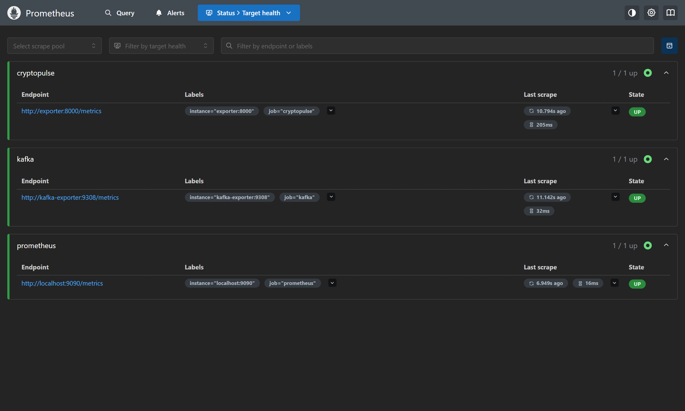
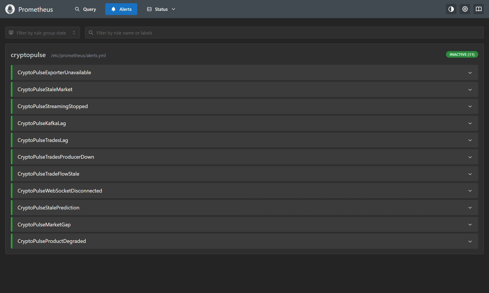
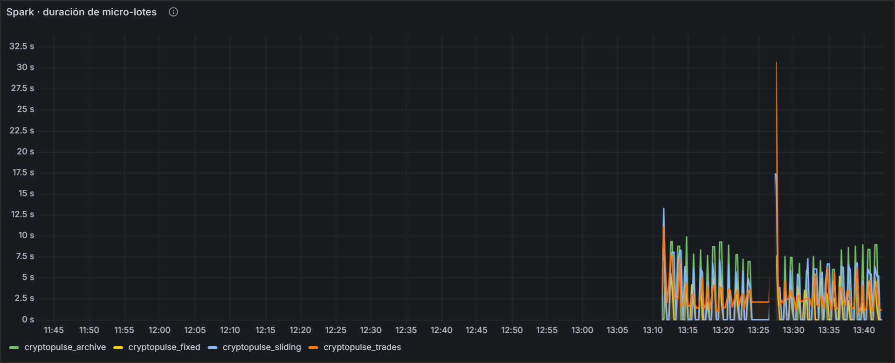
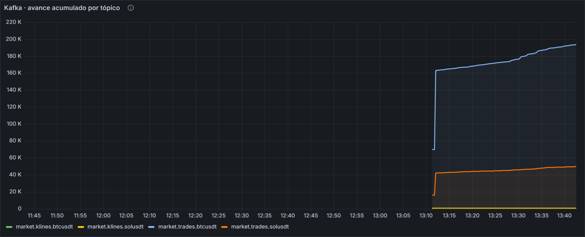
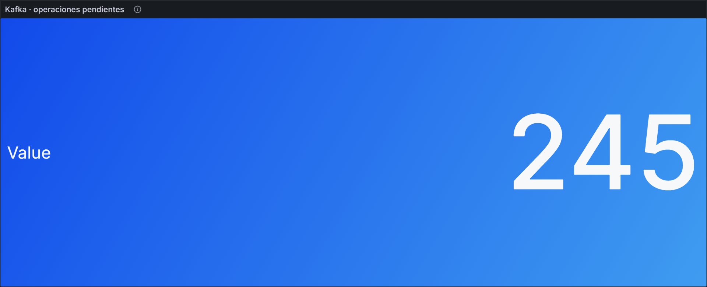
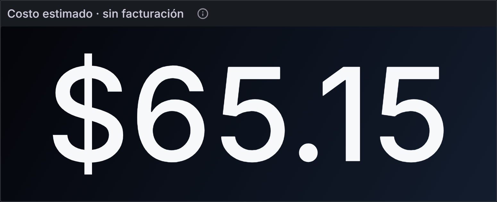
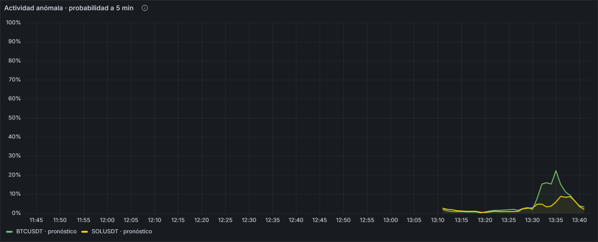

<h1>Abdul Quispe Condori</h1>

<strong>¿Qué probabilidad hay de que en los próximos 5 minutos el volumen o las operaciones sean inusualmente altos para esa hora del día?</strong>

Página adaptada a mi dimensión, con la estructura de la [plantilla del docente](../proyecto-sello/u2-producto.md).

## Producto

Observabilidad y costos del pipeline, y pronóstico en streaming de la actividad anómala.

### Evolución desde U1

| | Unidad 1 | Unidad 2 |
|---|---|---|
| **Pregunta** | ¿Cuándo hubo volumen u operaciones inusualmente altos, por mes y por hora? | ¿Qué probabilidad hay de que en los próximos 5 minutos el volumen o las operaciones sean inusualmente altos para esa hora del día? |
| **Resultado** | Notebook batch que comparó referencia, dos logísticas y Random Forest. Ganó la logística L2, con AUC-PR de validación 0,820. | La logística calibrada se aplica cada minuto y se evalúa a los 5 minutos, y la misma disciplina de medir se extendió al pipeline con métricas y alertas. |

## 1. Alcance de capacidades por sesión

En negrita, lo que sustento como propio.

| Sesión | Capacidad en mi dimensión | Evidencia |
|---|---|---|
| S6, S7 | Mi modelo consume las velas de Kafka | Infraestructura de Julmer |
| S8 | Mis paneles usan las duraciones de micro-lote de Spark | `stream.py` |
| **S9** | **Métricas, 11 alertas, costos y criterios de escalado** | `exporter.py`, `observability/`, [costos](../proyecto-sello/u2-producto.md#costos) |
| **S10** | **Logística calibrada en vivo** | Panel de actividad |
| **S11** | **Panel de actividad y sección *Operación* del tablero** | *Actividad anómala · probabilidad a 5 min* |
| **S12** | **Sustentación de la operación y de mi dimensión** | Esta página |

## 2. Rúbrica de Evaluación

| Criterio | Peso | Mi evidencia |
|---|---:|---|
| 1. Ingesta de eventos empresariales | 12% | Trabajo de Julmer |
| 2. Ingesta de eventos IoT/sensores | 10% | Trabajo de Julmer; de aquí sale mi modelo |
| 3. Procesamiento streaming | 14% | Trabajo de Julmer; mido sus lotes |
| 4. Observabilidad | 12% | Mi trabajo: panel, alertas y correlación |
| 5. Costos y escalado | 8% | Mi trabajo: estimación y umbrales de escalado |
| 6. Salidas BI/ML | 12% | Mi panel junto a la actividad observada |
| 7. Series de tiempo validada | 12% | Mejor resultado en la prueba; en vivo por debajo en BTC |
| 8. Sustentación | 20% | Esta página y el [guion](demo.md) |

Niveles A, B, C y D completos en la [Tabla 2](../proyecto-sello/u2-producto.md#2-rubrica-de-evaluacion).

### Evidencia de observabilidad

Cómo se correlacionan: si la duración del lote supera los 15 s, deberían crecer los eventos pendientes en Kafka y después la edad de la última ventana. Si solo crece la edad de señal del productor, el problema está en la ingesta y no en Spark.

### Costos

Estimación de 65,15 USD al mes con tarifas ilustrativas; no es una factura ni una cotización.

### Mi panel en vivo

### Métricas

| Medición | Modelo | Referencia |
|---|---:|---:|
| PR-AUC, prueba 2026 (n = 52 412) | **0,660** | 0,072 |
| Brier, prueba 2026 | **0,0391** | 0,0658 |
| Precisión y recall en el umbral | 0,569 y 0,636 | 0 y 0 |
| MAE en vivo, BTC (n = 85) | 0,112 | **0,070** |
| MAE en vivo, SOL (n = 84) | 0,073 | 0,075 |

Cifras en vivo del 30 de octubre de 2026, de 15:07 a 18:34 UTC. Son una muestra corta.

### Cómo explicarlo

- **Indicador:** probabilidad de superar el percentil 95 de volumen u operaciones para ese activo y esa hora UTC.
- **Por qué por hora:** el volumen normal cambia durante el día; un umbral único confundiría el horario activo con una anomalía.
- **Límite real:** en vivo, en BTC, el error es mayor que el de la referencia. La muestra es corta, pero es lo primero que hay que seguir vigilando.

## 3. Trazabilidad

Los criterios 6 y 7 son la evidencia de CE044-N3 y CE043-N3. Mi modelo de U1 completa aquí CE043 al aplicarse en streaming y validarse con métricas. [Trazabilidad completa](../proyecto-sello/u2-producto.md#3-trazabilidad-y-procedencia-de-la-rubrica).
