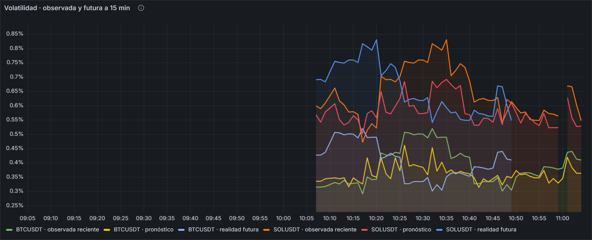

<h1>Franck Albertson Coaquira Justo</h1>

<strong>¿Qué volatilidad tendrá cada activo en los próximos 15 minutos?</strong>

Sesiones de la Unidad 2: S10, S11 y S12

## Mi aporte

| Sesión | Qué hice | Evidencia |
|---|---|---|
| **S10** | Pronóstico de volatilidad con Random Forest, emitido cada minuto para BTC y SOL | [`inference.py`](https://github.com/Milagros-hp/BigData-BTC-SOL/blob/main/pyspark/sesiones/cryptopulse/inference.py) |
| **S11** | Mi dimensión en el tablero, con observado, pronóstico y realidad posterior | Panel *Volatilidad · observada y futura a 15 min* |
| **S12** | Sustentación de la dimensión y su lectura de riesgo | Esta página y la demo |

## Mi panel en vivo

## Validación

| Medición | Modelo | Referencia |
|---|---:|---:|
| RMSE, prueba enero a septiembre de 2026 (n = 52 412) | **0,129** | 0,151 |
| MAE, prueba enero a septiembre de 2026 | **0,079** | 0,085 |
| MAE en vivo, primera hora (n = 90) | **0,089** | 0,118 |

Es la única dimensión que supera a su referencia con claridad tanto en la prueba como en la primera hora en vivo.

## Cómo explicarlo

- **Indicador:** 100 por la raíz de la suma de cuadrados de 15 rendimientos logarítmicos de 1 minuto, sin anualizar.
- **Sin fuga de información:** las variables solo usan velas ya cerradas; el futuro solo se usa como etiqueta y para evaluar.
- **Límite real:** en vivo se ve que el pronóstico sigue un rango más estrecho que la realidad, así que puede quedarse corto en los picos.
