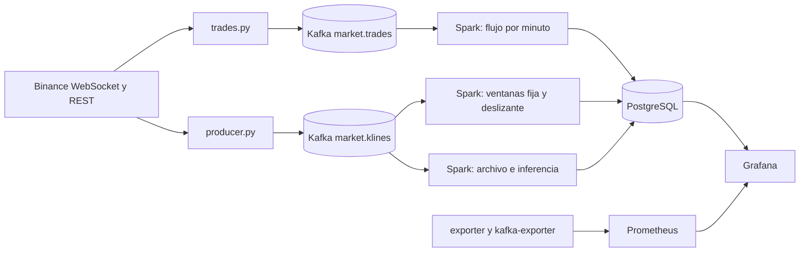

---
hide:
  - navigation
  - toc
---

Big Data · UPeU 2026-2 · Grupo 3 · Producto de Unidad 2

# CryptoPulse en tiempo real

Del histórico de la Unidad 1 a un pipeline vivo: cada operación y cada minuto de BTC y SOL entran por Kafka, pasan por Spark y terminan como riesgo pronosticado en un solo tablero.

¿Cómo puede un analista de riesgo anticipar, con 5 a 30 minutos de antelación, volatilidad alta, caídas fuertes, actividad anómala y desacople entre BTC y SOL?

<b>2</b>flujos reales en Kafka: operaciones y velas

<b>79 744</b>operaciones en ventanas durante la primera hora

<b>7/7</b>pronósticos vigentes cada minuto

<b>11</b>alertas operativas en Prometheus

<b>4,6 s</b>duración media del lote, con intervalo de 15 s

<b>65 USD</b>por mes, estimación con tarifas ilustrativas

## De la Unidad 1 a la Unidad 2

| | Unidad 1 | Unidad 2 |
|---|---|---|
| **Datos** | 4 993 757 velas históricas validadas | Operaciones y velas en vivo desde Binance |
| **Proceso** | Batch con PySpark y Parquet | Spark Structured Streaming con ventanas, watermark y checkpoints |
| **Modelos** | Entrenados y evaluados con historia | Aplicados cada minuto y evaluados cuando madura el horizonte |
| **Salida** | Notebooks por integrante | Tablero Grafana en vivo, con operación y costos |

## El equipo y su aporte

<a class="cp-member cp-franck" href="franck/"><strong>Franck Coaquira</strong><em>Volatilidad a 15 min</em>S10S11S12<small>Modelo Random Forest en vivo</small></a>
<a class="cp-member cp-julmer" href="julmer/"><strong>Julmer Quispe</strong><em>Caída fuerte a 30 min</em>S6S7S8S10S12<small>Kafka, contratos y Spark</small></a>
<a class="cp-member cp-abdul" href="abdul/"><strong>Abdul Quispe</strong><em>Actividad anómala a 5 min</em>S9S10S12<small>Prometheus, alertas y costos</small></a>
<a class="cp-member cp-luz" href="luz/"><strong>Luz Milagros Huanca</strong><em>Separación BTC–SOL a 15 min</em>S10S11S12<small>Tablero BI, scripts y CI</small></a>

## El camino: sesión 6 a sesión 12

<b>S6</b>Eventos empresariales: operaciones ejecutadas en <code>market.trades.*</code><small>Julmer</small>

<b>S7</b>Telemetría de mercado: velas de 1 minuto en <code>market.klines.*</code><small>Julmer</small>

<b>S8</b>Spark Streaming: 4 consultas, ventanas, watermark y checkpoints<small>Julmer</small>

<b>S9</b>Observabilidad, alertas, costos y criterios de escalado<small>Abdul</small>

<b>S10</b>Inferencia en streaming: un modelo por integrante<small>Los cuatro</small>

<b>S11</b>Tablero BI: KPIs y predicción en la misma vista<small>Luz Milagros</small>

<b>S12</b>Integración, pruebas de recuperación y sustentación<small>Luz Milagros y equipo</small>

[Ver cada sesión con su evidencia](sesiones.md){ .md-button .md-button--primary } [Guion de la demo](demo.md){ .md-button }

## Arquitectura

## El producto en vivo

<figure markdown>

<figcaption>Tablero único en estado LISTO, 30 de octubre de 2026. Captura automática del producto en ejecución.</figcaption>
</figure>

## Lo que probamos, no solo lo que construimos

| Prueba | Resultado |
|---|---|
| Evento duplicado | Se cuenta una sola vez, en velas y en operaciones |
| Evento tardío | Se descarta por watermark |
| Reinicio de Spark | Continúa desde su checkpoint |
| Caída del productor de velas | El estado pasa a degradado y se recupera sin huecos |
| Caída del productor de operaciones | El estado pasa a degradado; recupera por REST y la verificación no encuentra minutos faltantes en BTC |

**Lectura honesta de los modelos.** En la prueba histórica reservada (enero a septiembre de 2026), los cuatro superan a su referencia. En la primera hora en vivo solo volatilidad la supera con claridad; caída queda empatada, y actividad y separación quedan por debajo. Una hora de un solo día no alcanza para concluir, por eso el tablero sigue midiéndolo.

