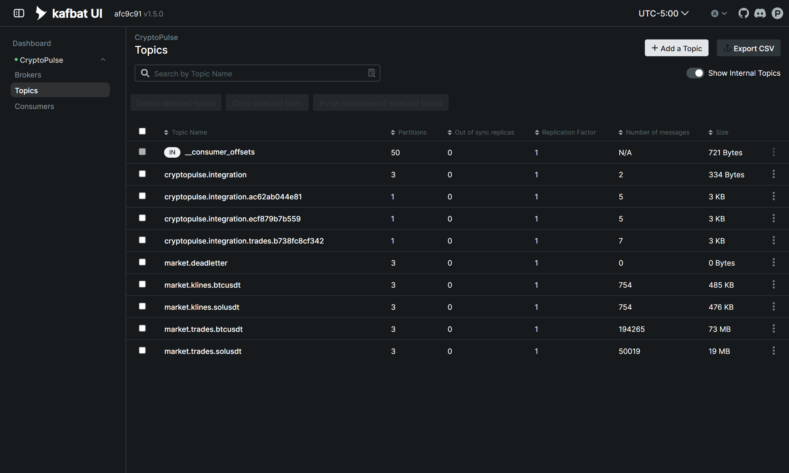
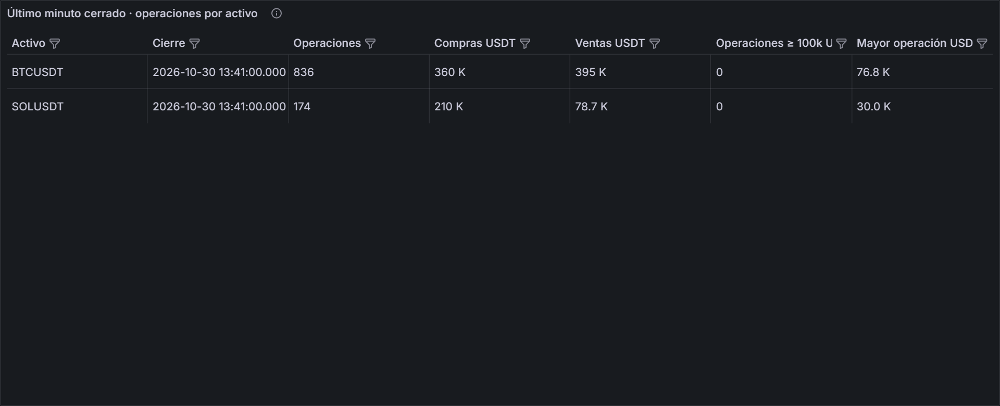
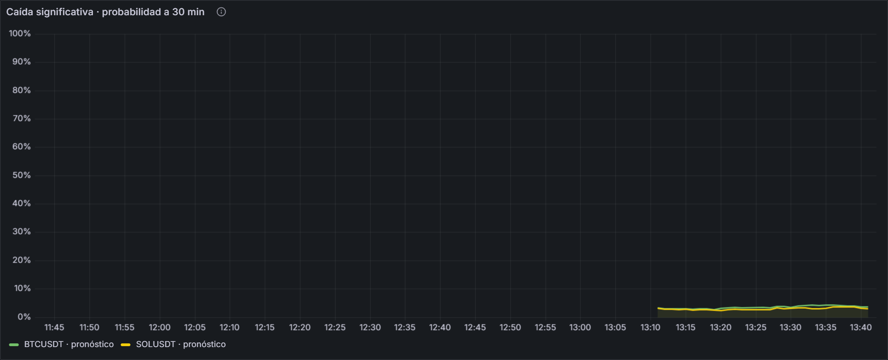

<h1>Julmer Quispe Apaza</h1>

<strong>¿Qué probabilidad hay de que BTC o SOL tengan una caída fuerte en los próximos 30 minutos?</strong>

Página adaptada a mi dimensión, con la estructura de la [plantilla del docente](../proyecto-sello/u2-producto.md).

## Producto

Ingesta con Kafka, procesamiento con Spark y pronóstico en streaming de la probabilidad de caída fuerte.

### Evolución desde U1

| | Unidad 1 | Unidad 2 |
|---|---|---|
| **Pregunta** | ¿Con qué frecuencia BTC y SOL tuvieron caídas fuertes a 30 minutos y en qué condiciones ocurren más? | ¿Qué probabilidad hay de que BTC o SOL tengan una caída fuerte en los próximos 30 minutos? |
| **Resultado** | Notebook batch que comparó referencia, dos logísticas y Random Forest. Ganó la logística L2, con AUC-PR de validación 0,125. | La logística calibrada se aplica cada minuto y se evalúa a los 30 minutos. Además, la dimensión ahora se apoya en la ingesta y el streaming del pipeline. |

## 1. Alcance de capacidades por sesión

En negrita, lo que sustento como propio.

| Sesión | Capacidad en mi dimensión | Evidencia |
|---|---|---|
| **S6** | **Operaciones ejecutadas con contrato versionado** | `trades.py`, `market-trade-v1.schema.json` |
| **S7** | **Velas por WebSocket con recuperación REST** | `producer.py`, `market-kline-v1.schema.json` |
| **S8** | **Cuatro consultas con ventanas, watermark y checkpoints** | `stream.py` |
| S9 | Mi serie tiene su propia alerta de pronóstico atrasado | `CryptoPulseStalePrediction` |
| **S10** | **Logística calibrada en vivo** | Panel de caída |
| **S11** | **Panel de probabilidad a 30 minutos** | *Caída significativa · probabilidad a 30 min* |
| **S12** | **Sustentación de la ingesta, el streaming y mi dimensión** | Esta página |

## 2. Rúbrica de Evaluación

| Criterio | Peso | Mi evidencia |
|---|---:|---|
| 1. Ingesta de eventos empresariales | 12% | Mi trabajo: publicación y consumo en vivo, con contrato |
| 2. Ingesta de eventos IoT/sensores | 10% | Mi trabajo: telemetría en el mismo Kafka |
| 3. Procesamiento streaming | 14% | Mi trabajo: ventanas, watermark y checkpoints |
| 4. Observabilidad | 12% | Trabajo de Abdul; Spark expone mis métricas |
| 5. Costos y escalado | 8% | Trabajo de Abdul; parte del volumen que yo mido |
| 6. Salidas BI/ML | 12% | Mi panel junto al flujo de operaciones |
| 7. Series de tiempo validada | 12% | Logística calibrada; en vivo está empatada con la referencia |
| 8. Sustentación | 20% | Esta página y el [guion](demo.md) |

Niveles A, B, C y D completos en la [Tabla 2](../proyecto-sello/u2-producto.md#2-rubrica-de-evaluacion).

### Evidencia de ingesta

### Evidencia de streaming

### Mi panel en vivo

### Métricas

| Medición | Modelo | Referencia |
|---|---:|---:|
| PR-AUC, prueba 2026 (n = 52 412) | **0,103** | 0,033 |
| Brier, prueba 2026 | **0,0250** | 0,0262 |
| Precisión y recall en el umbral | 0,135 y 0,262 | 0 y 0 |
| MAE en vivo, BTC (n = 63) | 0,095 | 0,093 |
| MAE en vivo, SOL (n = 62) | 0,108 | 0,108 |

Cifras en vivo del 30 de octubre de 2026, de 15:07 a 18:34 UTC. Son una muestra corta.

### Cómo explicarlo

- **Indicador:** probabilidad calibrada de que el rendimiento a 30 minutos caiga bajo el percentil 5 del entrenamiento de ese activo.
- **Sin fuga de información:** solo velas cerradas y embargo de 30 minutos entre particiones.
- **Garantía de entrega:** al menos una vez, con resultados idempotentes; no es exactamente una vez.
- **Límite real:** en la prueba, de cada 100 alertas unas 14 aciertan. Sirve para priorizar una revisión, no para decidir sola.

## 3. Trazabilidad

Los criterios 6 y 7 son la evidencia de CE044-N3 y CE043-N3. Mi modelo de U1 completa aquí CE043 al aplicarse en streaming y validarse con métricas. [Trazabilidad completa](../proyecto-sello/u2-producto.md#3-trazabilidad-y-procedencia-de-la-rubrica).
