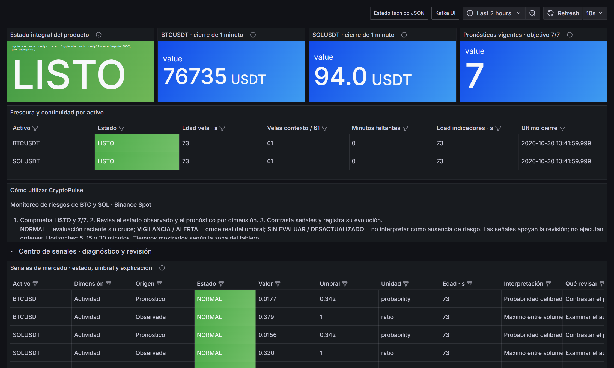
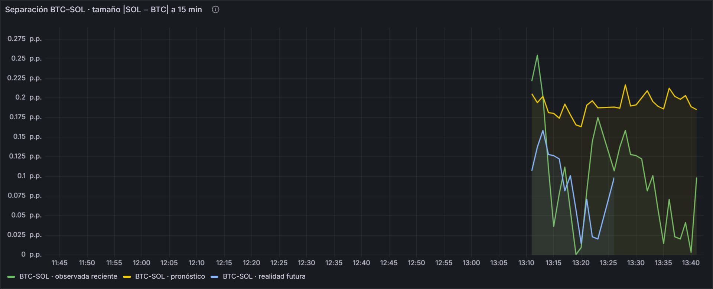

<h1>Luz Milagros Huanca Pacco</h1>

<strong>¿Qué tamaño de separación entre los rendimientos de SOL y BTC se espera en los próximos 15 minutos?</strong>

Página adaptada a mi dimensión, con la estructura de la [plantilla del docente](../proyecto-sello/u2-producto.md).

## Producto

Tablero BI, operación del pipeline y pronóstico en streaming de la separación entre activos.

### Evolución desde U1

| | Unidad 1 | Unidad 2 |
|---|---|---|
| **Pregunta** | ¿Cuánto se separaron los rendimientos de SOL y BTC en ventanas de 15 minutos, y cuándo se desacoplan más? | ¿Qué tamaño de separación entre los rendimientos de SOL y BTC se espera en los próximos 15 minutos? |
| **Resultado** | Notebook batch de regresión del tamaño de la separación, con referencia del promedio histórico. Predecir la dirección con signo no mejoró la referencia cero. | Ridge se aplica cada minuto sobre ambos activos y se evalúa a los 15 minutos. La dimensión se muestra junto a los KPIs en el tablero que integra todo el equipo. |

## 1. Alcance de capacidades por sesión

En negrita, lo que sustento como propio.

| Sesión | Capacidad en mi dimensión | Evidencia |
|---|---|---|
| S6, S7 | Mi modelo consume las velas de ambos activos desde Kafka | Infraestructura de Julmer |
| S8 | Mi inferencia corre en la consulta de archivo de Spark | `stream.py` |
| S9 | Mi serie tiene su propia alerta de pronóstico atrasado | `CryptoPulseStalePrediction` |
| **S10** | **Ridge en vivo para el par BTC–SOL** | Panel de separación |
| **S11** | **Tablero BI único con KPIs y predicción** | `generar_dashboard.py`, `cryptopulse.json` |
| **S12** | **Scripts, CI, documentación e integración** | `scripts/`, `.github/workflows/`, `mkdocs.yml` |

## 2. Rúbrica de Evaluación

| Criterio | Peso | Mi evidencia |
|---|---:|---|
| 1. Ingesta de eventos empresariales | 12% | Trabajo de Julmer |
| 2. Ingesta de eventos IoT/sensores | 10% | Trabajo de Julmer; de aquí sale mi modelo |
| 3. Procesamiento streaming | 14% | Trabajo de Julmer; ahí corre mi inferencia |
| 4. Observabilidad | 12% | Trabajo de Abdul; incluye la alerta de mi serie |
| 5. Costos y escalado | 8% | Trabajo de Abdul |
| 6. Salidas BI/ML | 12% | Tablero completo con KPIs y predicción en la misma vista |
| 7. Series de tiempo validada | 12% | Ridge validado en prueba 2026; en vivo supera por poco a la referencia |
| 8. Sustentación | 20% | Esta página y el [guion](demo.md) |

Niveles A, B, C y D completos en la [Tabla 2](../proyecto-sello/u2-producto.md#2-rubrica-de-evaluacion).

### Evidencia del tablero

### Mi panel en vivo

### Métricas

| Medición | Modelo | Referencia |
|---|---:|---:|
| RMSE, prueba 2026 (n = 26 207) | **0,149** | 0,198 |
| MAE, prueba 2026 | **0,107** | 0,170 |
| MAE en vivo (n = 75) | **0,119** | 0,126 |

Cifras en vivo del 30 de octubre de 2026, de 15:07 a 18:34 UTC. Son una muestra corta.

### Cómo explicarlo

- **Indicador:** tamaño de la separación |SOL − BTC| en puntos porcentuales.
- **Decisión clave:** predecir la dirección no mejoró la referencia cero, así que la dimensión se reformuló como tamaño.
- **Resultado de la integración:** `pruebas_integracion.ps1`, `verificar_producto.ps1` y `prueba_recuperacion.ps1` en PASS el 30 de octubre.
- **Límite real:** la ventaja en vivo es pequeña y de un solo día; todavía no confirma la prueba histórica.

## 3. Trazabilidad

Los criterios 6 y 7 son la evidencia de CE044-N3 y CE043-N3. Mi modelo de U1 completa aquí CE043 al aplicarse en streaming y validarse con métricas. [Trazabilidad completa](../proyecto-sello/u2-producto.md#3-trazabilidad-y-procedencia-de-la-rubrica).
