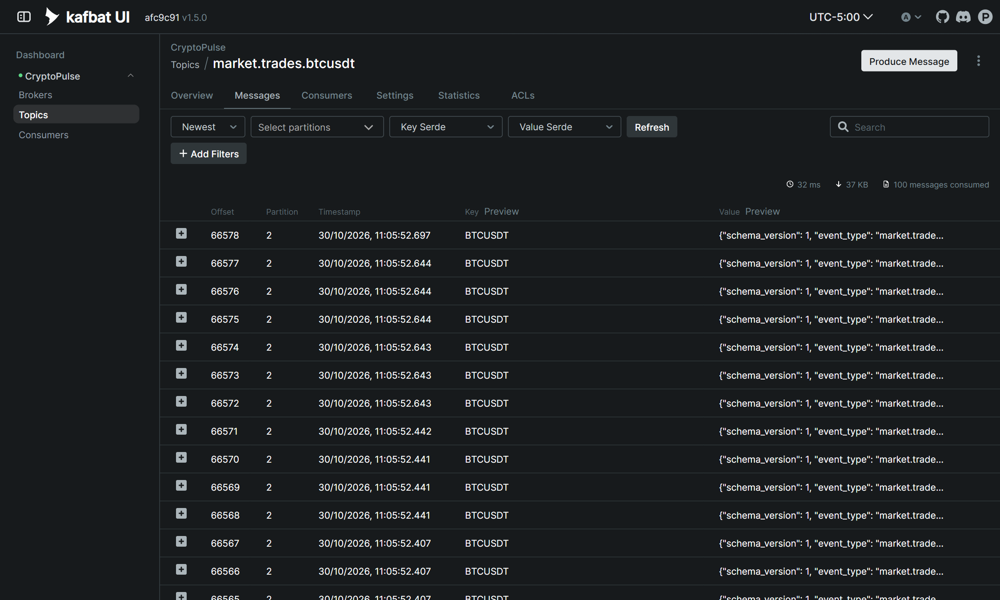
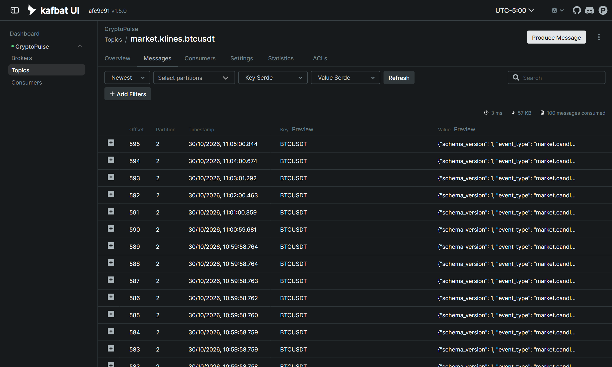
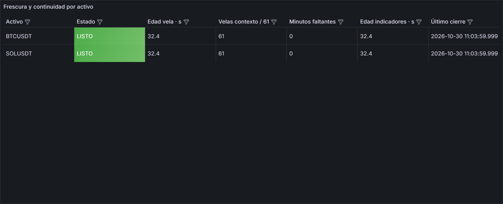
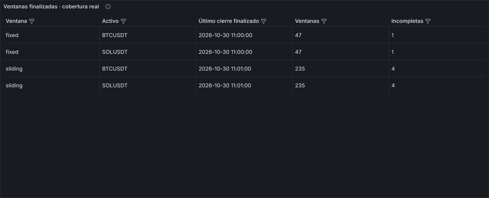
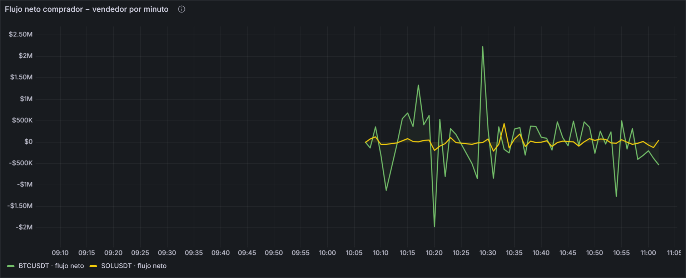
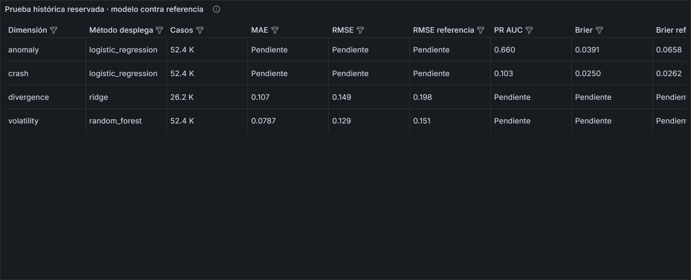
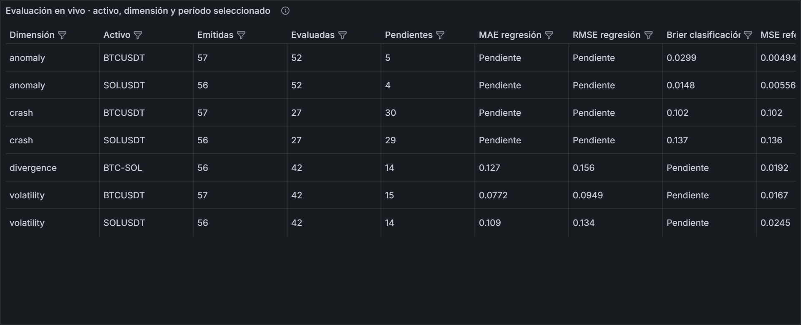
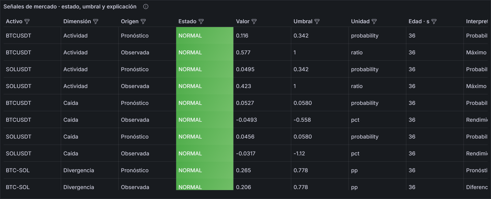
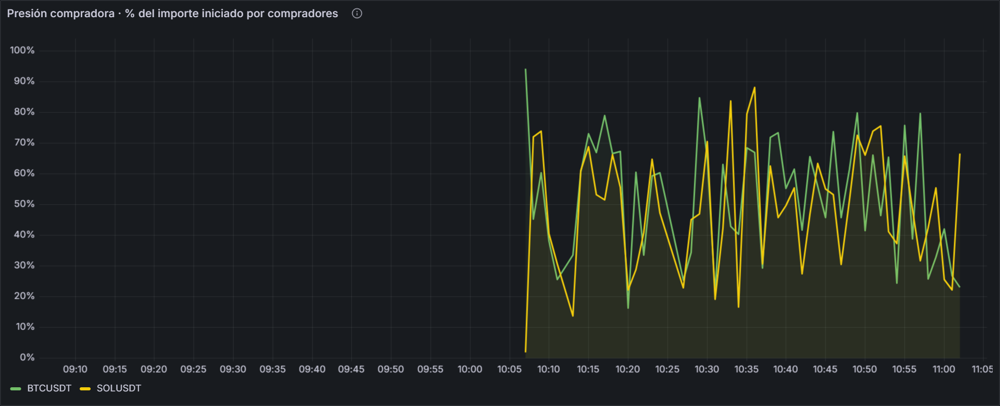
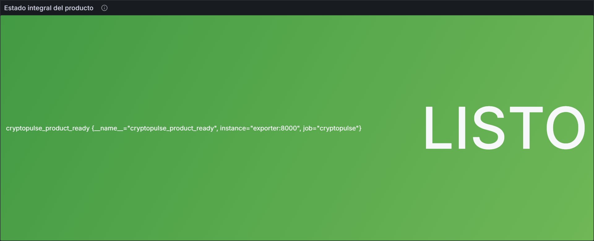

# Sesión por sesión · S6 a S12

Cada sesión muestra el responsable declarado en [Equipo y aporte individual](../equipo.md), qué se construyó y cómo se comprueba. Las capturas son del producto en ejecución el 30 de octubre de 2026.

## S6 · Eventos empresariales con Kafka { #s6 }

**Responsable: Julmer.** Cada operación ejecutada en Binance es un evento de negocio con precio, cantidad y lado comprador o vendedor. Se publica en `market.trades.btcusdt` y `market.trades.solusdt`, con contrato versionado.

- **Código:** [`trades.py`](https://github.com/Milagros-hp/BigData-BTC-SOL/blob/main/pyspark/sesiones/cryptopulse/trades.py) y [`market-trade-v1.schema.json`](https://github.com/Milagros-hp/BigData-BTC-SOL/blob/main/schemas/market-trade-v1.schema.json).
- **Comprobación:** `cryptopulse.verify 6` publica y lee un mensaje, y valida contra el contrato la última operación real de cada tópico.

## S7 · Telemetría de mercado { #s7 }

**Responsable: Julmer.** La guía admite sensores simulados o telemetría. Usamos telemetría real: la vela de 1 minuto es una lectura periódica del mercado, con frecuencia fija de 2 mensajes por minuto, y entra al mismo Kafka. No hay datos simulados.

- **Código:** [`producer.py`](https://github.com/Milagros-hp/BigData-BTC-SOL/blob/main/pyspark/sesiones/cryptopulse/producer.py) y [`market-kline-v1.schema.json`](https://github.com/Milagros-hp/BigData-BTC-SOL/blob/main/schemas/market-kline-v1.schema.json).
- **Comprobación:** 61 de 61 velas por activo, 0 minutos faltantes y 0 eventos rechazados.

## S8 · Spark Structured Streaming { #s8 }

**Responsable: Julmer.** Cuatro consultas con checkpoint propio:

| Consulta | Ventana | Watermark | Salida |
|---|---|---|---|
| Archivo e inferencia | Sin ventana, por micro-lote | No aplica | `market_candles`, `predictions` |
| Ventana fija | 5 min | 2 min | `stream_windows` |
| Ventana deslizante | 5 min, paso de 1 min | 2 min | `stream_windows` |
| Flujo de operaciones | 1 min | 1 min | `trade_flow` |

- **Código:** [`stream.py`](https://github.com/Milagros-hp/BigData-BTC-SOL/blob/main/pyspark/sesiones/cryptopulse/stream.py).
- **Comprobación:** `pruebas_integracion.ps1` cubre duplicados, eventos tardíos y reinicio por checkpoint en velas y operaciones, con tópicos aislados.

## S9 · Observabilidad y costos { #s9 }

**Responsable: Abdul.** Prometheus con 3 destinos y 11 alertas. El tablero permite correlacionar duración de lotes, eventos pendientes en Kafka y edad de cada flujo. Los [costos y criterios de escalado](../proyecto-sello/u2-producto.md#costos) parten del volumen medido.

## S10 · Inferencia en streaming { #s10 }

**Responsables: los cuatro, un modelo cada uno.** En cada cierre de minuto se aplican los modelos a las últimas 61 velas y salen 7 pronósticos. Cada uno se evalúa cuando madura su horizonte.

| Dimensión | Responsable | Modelo | Métrica en prueba 2026 | Modelo | Referencia |
|---|---|---|---|---:|---:|
| Volatilidad a 15 min | Franck | Random Forest | RMSE | 0,129 | 0,151 |
| Caída a 30 min | Julmer | Logística calibrada | PR-AUC | 0,103 | 0,033 |
| Actividad a 5 min | Abdul | Logística calibrada | PR-AUC | 0,660 | 0,072 |
| Separación a 15 min | Luz Milagros | Ridge | RMSE | 0,149 | 0,198 |

## S11 · Tablero BI y predicción { #s11 }

**Responsable: Luz Milagros.** Un solo tablero reúne estado, señales, pronóstico frente a realidad, evaluación, operación y flujo de operaciones.

## S12 · Integración y sustentación { #s12 }

**Responsables: Luz Milagros en DataOps; cada integrante sustenta su dimensión.** La integración se comprueba con tres scripts:

| Script | Qué comprueba | Resultado del 30 de octubre |
|---|---|---|
| `pruebas_integracion.ps1` | Contrato, duplicados, tardíos, checkpoints y modelos | PASS |
| `verificar_producto.ps1` | Sesiones S03 a S12 contra el sistema vivo | PASS |
| `prueba_recuperacion.ps1` | Caída y recuperación de ambos productores | PASS |

